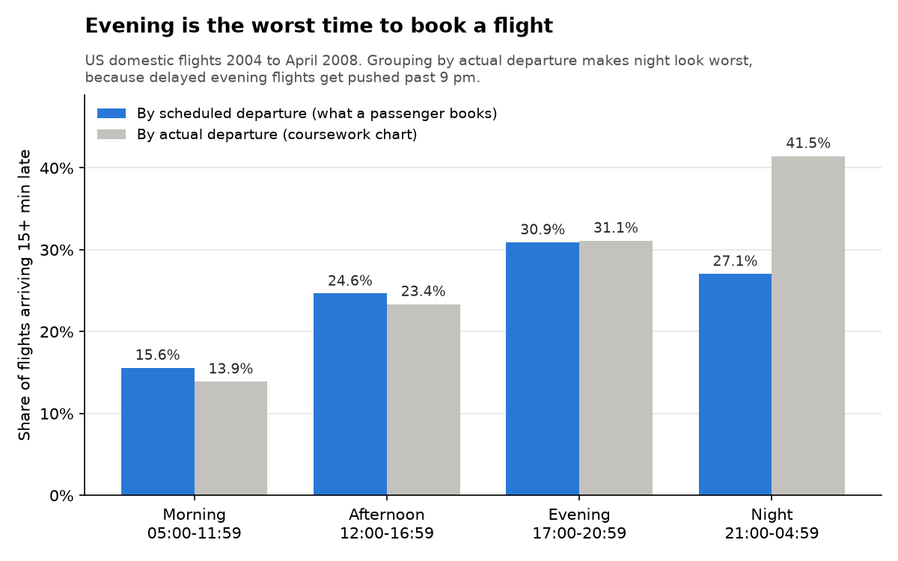
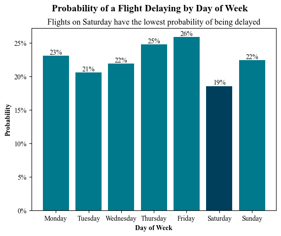
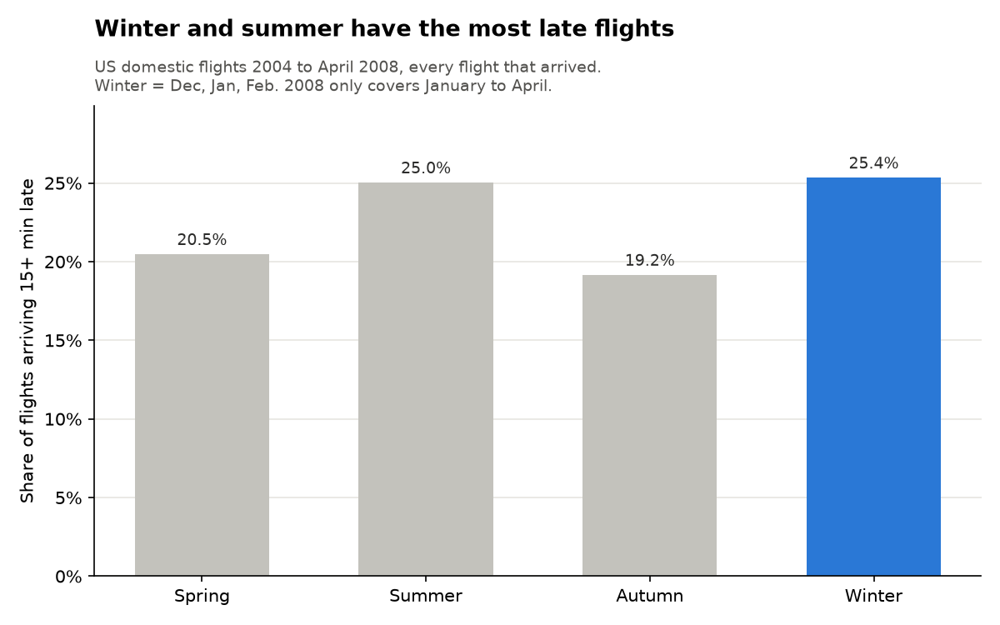
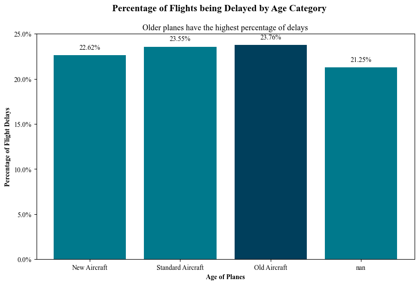
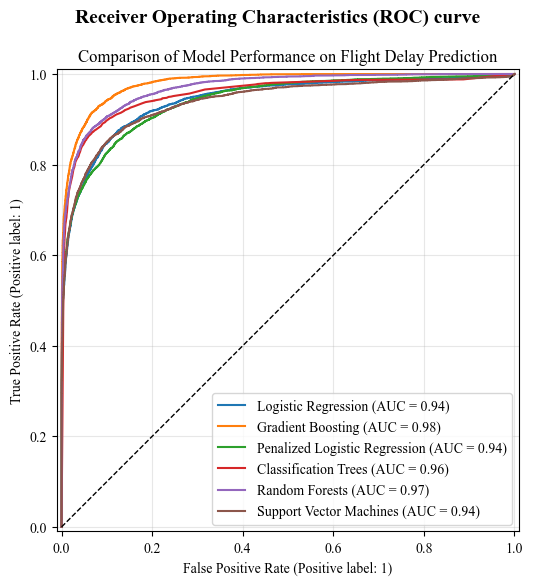
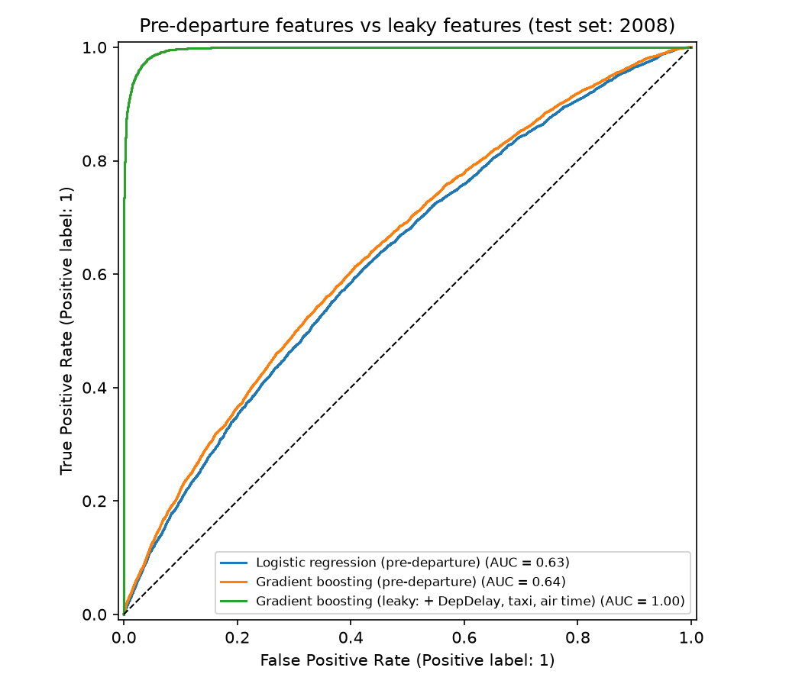
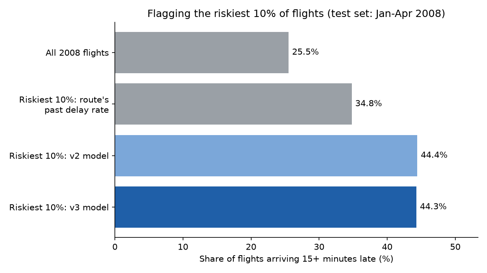
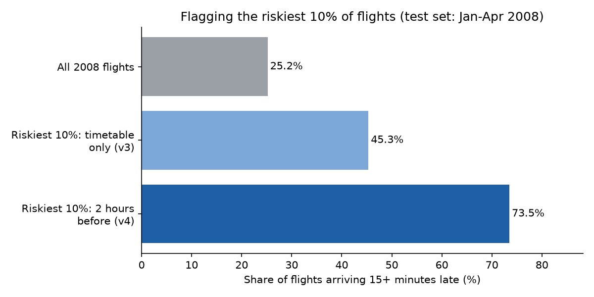
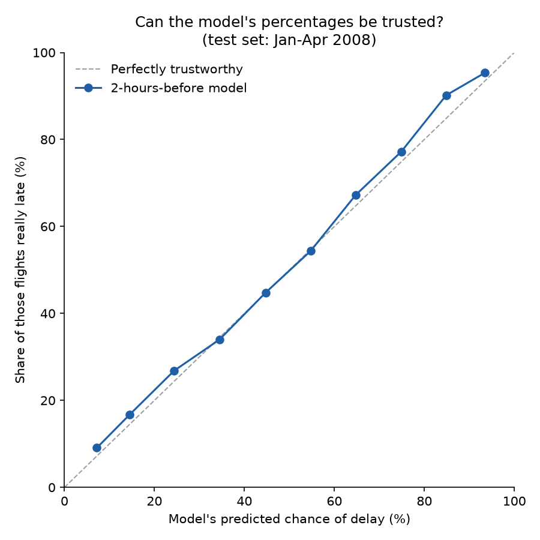

# ✈️ Flight Delay Analysis and Prediction

[](https://github.com/mattimathics/Flight-Delay-Prediction/actions/workflows/tests.yml)

**What makes US flights late, and can we predict a delay before the plane leaves?**

I analysed 31 million US domestic flights (2004–2008) in Python, R and SQL. Then I built a model to predict delays. My first model looked almost perfect, but it was cheating: it used information that only exists after take-off. I found the problem, rebuilt the model honestly, and kept both results side by side.

## In 30 seconds

- **Data:** 31 million flights, loaded into a SQLite database.
- **Best time to fly:** the morning. 15.6% of flights scheduled to leave in the morning are late, against 30.9% in the evening.
- **The model:** the first version scored 0.93–0.98 AUC, which was too good to be true. It used the departure delay to predict the arrival delay. With only the timetable, the honest score is **0.642**. Predicting 2 hours before departure, using only what has already happened that day, it rises to **0.751**.
- **What it's good for:** 2 hours out, the 10% of flights the model rates riskiest are late 72% of the time, against 25.5% for all 2008 flights. An airline could send standby crews and spare gates to that list.
- **The lesson:** always check *when* each piece of information becomes known.



## The questions

Using the [ASA Data Expo 2009](https://doi.org/10.7910/DVN/HG7NV7) flight data, I asked five questions:

1. When is the best time of day, day of week and time of year to fly?
2. Do older planes have more delays?
3. How has the number of flights between states changed?
4. Does one late flight make the same plane's next flight late?
5. Can a model predict whether a flight will arrive 15+ minutes late?

## What I found

| Question | Answer |
|---|---|
| Time of day | Mornings are best (15.6% late). Evenings are worst (30.9%).* |
| Day and season | Friday is the worst day (25.9%) and Saturday the best (18.5%). Winter (25.4%) and summer (25.0%) are the worst seasons, and autumn the best (19.2%). |
| Plane age | Age makes little difference: planes over 20 years old are late 23.9% of the time, against 22.6% for planes up to 10 years old.† |
| Number of flights | Flights started falling across the US in December 2007. |
| Knock-on delays | By following each plane's tail number, I traced how a late arrival makes the same plane's next departure late. |
| Prediction | See the model section below. |

\*These rates group flights by their **scheduled** departure time, the time a passenger sees when booking. My coursework chart grouped them by **actual** departure time instead, which made night look worst (41.5%). That was misleading: an evening flight that runs late and leaves after 9 pm gets counted as a "night" flight, so night collects other slots' delays. The chart at the top shows both groupings side by side.

| Time of day | Late, grouped by scheduled departure | Late, grouped by actual departure | Flights (by scheduled time) |
|---|---|---|---|
| Morning (05:00–11:59) | 15.6% | 13.9% | 12,365,755 |
| Afternoon (12:00–16:59) | 24.6% | 23.4% | 9,621,903 |
| Evening (17:00–20:59) | **30.9%** | 31.1% | 6,953,325 |
| Night (21:00–04:59) | 27.1% | 41.5% | 1,637,795 |

These come from all 30,578,778 flights that arrived (cancelled and diverted flights have no arrival delay, so they are left out). `src/time_of_day.py` recomputes them and redraws the chart.

†Plane age is the flight's year minus the year the plane was built. A quarter of flights (7,658,924) have no usable build year, either because the plane is missing from the plane data or because its year is blank or 0, so they are left out of the age groups. My coursework version counted the planes with year 0 as about 2,000 years old, which put them in the "old" group. The gap that remains is also a plain comparison: older planes may fly for different airlines or routes, so it doesn't show that age itself causes delays.

The day, season and plane-age numbers come from `src/findings.py`, which counts every arrived flight, saves the tables to `results/` and redraws these charts:

| Day of week | Season | Plane age |
|---|---|---|
|  |  |  |

## The model, and the mistake I found

**Step 1: the first model looked too good.** For my coursework, I compared six models:

- logistic regression
- penalised logistic regression
- decision tree
- random forest
- gradient boosting
- support vector machine

I tuned them with grid search in scikit-learn and compared them with cross-validation in R (mlr3). Every one scored an AUC between 0.93 and 0.98.



**Step 2: why it was too good.** The models were given the departure delay, taxi times and time in the air. None of these is known until the plane has left. If a flight leaves 40 minutes late, it will almost certainly arrive late, so the model was partly being told the answer. This is called **target leakage**. One clue: even the simplest model did as well as the most complex one.

**Step 3: the honest version** (`src/model_v2.py`). I rebuilt the model using only what is known before departure:

- scheduled departure and arrival times
- route, airline and distance
- month and day of the week
- the age of the plane

It learns from 2004–2007 flights and is tested on 2008 flights, as a real forecast would be. The leaky version is kept alongside so you can see the gap.

| Model | Information used | Score on 2008 flights (AUC) |
|---|---|---|
| Logistic regression | Before departure only | 0.628 |
| Gradient boosting | Before departure only | **0.642** |
| Gradient boosting | Plus departure delay, taxi and air time (leaky) | 0.996 |

These models learned from a 1% sample: 282,717 flights from 2004–2007. They were tested on 23,363 flights from 2008. The 2008 data only covers January to April. (An earlier version of this README said 0.627, 0.641 and 0.997. Those came from a random sample that could not be repeated. The script now picks the same sample every time, and these are its numbers.)



**What this means.** Predicting a delay from the timetable alone is hard. A score of about 0.64 is a modest but real signal. Adding the departure delay pushes it to 0.997, and that jump is the leakage. It is why the coursework scores were too good to be true.

**Step 4: can the honest model do better?** (`src/model_v3.py`). I added three more things an airline knows before departure:

- **Airport busyness:** how many flights are scheduled to leave the origin airport in the same hour of the same day, and how many are scheduled to land at the destination. A busy hour means queues on the runway.
- **Route history:** the share of flights on the same route that were late in 2004–2007. Only the training years are used, so the 2008 test flights never feed into it. Routes with few flights are pulled towards the overall average, so a route flown 3 times can't get an extreme rate.

I also compared every model against a simple **benchmark**: no model at all, just rank flights by their route's past delay rate. A model is only worth having if it beats that.

| Method | Score on 2008 flights (AUC) | Late, among the riskiest 10% | Share of all late flights caught |
|---|---|---|---|
| Benchmark: route's past delay rate | 0.589 | 34.8% | 13.6% |
| v2 gradient boosting | 0.642 | 44.4% | 17.4% |
| v2 + airport busyness | 0.644 | 44.1% | 17.3% |
| v2 + route history | 0.641 | 44.1% | 17.3% |
| v3 gradient boosting (both added) | 0.642 | 44.3% | 17.4% |
| v3 logistic regression (both added) | 0.633 | 42.1% | 16.5% |

Same 1% sample and same 2008 test flights as Step 3. Across all 2008 test flights, 25.5% were late.



**What this means.**

- **The model beats the benchmark clearly.** Its riskiest 10% of flights are late 44% of the time: 1.7 times the average. Ranking by route history alone gives 35%.
- **The new features did not help gradient boosting.** It already knows the airport, route, airline and hour, so it had worked out most of this for itself. They did help the simpler logistic regression (0.628 → 0.633).
- **More data helps a little, not a lot.** With a 5% sample (1,412,072 training flights), gradient boosting scored 0.647 with or without the new features (`python src/model_v3.py --pct 5`).
- **The timetable alone has a ceiling of about 0.65.** Most delays come from things that happen on the day, like weather and late incoming planes. Getting past that ceiling means predicting closer to departure, using what has already gone wrong that day.

**Step 5: predicting 2 hours before departure** (`src/model_v4.py`). An airline re-plans crews and gates a couple of hours ahead, and by then it knows more. I moved the prediction to 2 hours before the scheduled departure and added only what is known at that moment:

- **The airport's earlier delays:** of the flights at the same airport scheduled to leave 2¼ to 5 hours before ours, the share that left 15+ minutes late. Stopping at 2¼ hours matters: a flight scheduled then has either left by the 2-hour mark, or is already known to be late.
- **The plane's turnaround:** the scheduled gap between the same plane landing here and our departure. A short gap leaves no room to catch up.
- **The plane's previous flight:** how late it took off, *only if it had taken off by the 2-hour mark*. Otherwise it is left blank, because we wouldn't know yet. Its take-off time is worked out as landing time minus flight time, so both are on our airport's clock.

This keeps the leakage rule from Step 2: nothing that happens after the 2-hour mark is used. An automated test changes everything after the cutoff (including the flight's own delay) and checks that none of these features move.

| Method | Score on 2008 flights (AUC) | Late, among the riskiest 10% | Share of all late flights caught |
|---|---|---|---|
| Benchmark: route's past delay rate | 0.589 | 34.8% | 13.6% |
| v3 gradient boosting (timetable only) | 0.642 | 44.3% | 17.4% |
| + airport's earlier delays only | 0.689 | 58.3% | 22.8% |
| + plane's previous flight only | 0.731 | 65.9% | 25.8% |
| v4 logistic regression (2 hours before) | 0.693 | 59.2% | 23.2% |
| v4 gradient boosting (2 hours before) | **0.751** | **72.1%** | **28.2%** |

Same 1% sample and same 2008 test flights as Steps 3 and 4. The airport's earlier delays are known for 84.7% of test flights, the turnaround for 76.8%, and the previous flight's delay for 52.9%. Early-morning flights, for example, have nothing earlier that day to learn from.



**What this means.**

- **What happened earlier that day matters more than anything in the timetable.** The plane's previous flight alone lifts the score from 0.642 to 0.731.
- **2 hours out, the riskiest 10% are late 72% of the time**, 2.8 times the average. That list holds 28% of all late flights.
- **This is still not leakage.** The leaky model scored 0.996 because it was given the flight's own delay. This one only sees other flights, and only what had already happened 2 hours before.
- **The two models answer different questions.** The timetable model (0.642) works weeks ahead, for planning schedules. The 2-hour model (0.751) works on the day, for operations.

**Step 6: can its percentages be trusted, and when should it raise an alert?** (`src/check_probabilities.py`). A ranking is useful, but an airline acting on "70% chance of delay" needs that 70% to be true. I grouped the 2008 test flights by the 2-hour model's predicted chance and checked how many in each group were really late.



| Predicted chance | Flights | Model's average prediction | Really late |
|---|---|---|---|
| 0–10% | 5,431 | 7.2% | 9.1% |
| 10–20% | 8,233 | 14.5% | 16.7% |
| 20–30% | 3,769 | 24.4% | 26.9% |
| 30–40% | 2,083 | 34.5% | 34.0% |
| 40–50% | 1,235 | 44.7% | 44.8% |
| 50–60% | 914 | 54.7% | 54.4% |
| 60–70% | 644 | 64.7% | 67.2% |
| 70–80% | 504 | 74.9% | 77.2% |
| 80–90% | 356 | 84.8% | 90.2% |
| 90–100% | 194 | 93.5% | 95.4% |

- **The percentages can be trusted.** On average, a group's prediction is 1.9 points away from what really happened, so no correction is needed.
- **Where they are off, they run a little low.** The model expects 23.7% of 2008 flights to be late; 25.5% were. Delays became more common every year (20% in 2004, 24.7% in 2007), and a model trained on the past can't know that 2008 would be worse still.

**Choosing an alert level.** It is worth acting on a flight when the expected cost of a delay is bigger than the cost of acting: chance of delay × cost of a missed delay > cost of acting. So the alert level is simply **cost of acting ÷ cost of a missed delay**. This only works because the percentages are trustworthy.

| Alert if chance is at least | Flights flagged | Late, among flagged | Share of all late flights caught |
|---|---|---|---|
| 20% | 41.5% | 42.3% | 68.7% |
| 25% | 32.1% | 47.5% | 59.6% |
| 30% | 25.4% | 52.0% | 51.7% |
| 40% | 16.5% | 61.8% | 39.9% |
| 50% | 11.2% | 69.9% | 30.6% |
| 70% | 4.5% | 84.9% | 15.0% |

For example, if a missed delay costs four times as much as acting (an illustration, not a real airline figure), the alert level is 1 ÷ 4 = 25%. The model would flag about a third of flights and catch 60% of late ones. If acting is expensive, raise the level: at 70%, it flags 4.5% of flights and 85% of them are really late. `--cost-of-acting` and `--cost-of-missed-delay` let you plug in real costs.

## Terms used

- **AUC:** how well a model ranks late flights above on-time ones. 0.5 is a coin flip and 1.0 is perfect.
- **Target leakage:** giving a model information it would not have at the time it makes its prediction.
- **Delayed:** arriving 15 or more minutes late. This is the US Federal Aviation Administration (FAA) definition.
- **Calibration:** whether a model's percentages match reality. If it says 30% for a group of flights, about 30% should be late.
- **Cutoff:** the moment the prediction is made. Anything that happens after it can't be used.
- **Time-based split:** training on earlier years and testing on a later year, so the model never sees the future.
- **Benchmark:** the simplest sensible way to do the job without a model. Here, ranking flights by how often their route was late in the past.

## Key choices, and why

- **A database instead of loading everything into memory.** 31 million rows don't fit comfortably in a laptop's memory. A SQLite database with indexes lets each query pull only the rows it needs.
- **Delay rates, not counts.** Busy times naturally have more delays, so every comparison uses the *share* of flights that were late.
- **The FAA definition of late:** 15+ minutes after schedule.
- **Test on a later year.** A random split would let the model learn from days it is later tested on. Training on 2004–2007 and testing on 2008 avoids that.
- **Always compare against a benchmark.** A score of 0.64 means little on its own. Beating the route's past delay rate (0.589) shows the model learned something history alone doesn't give you.
- **Report a result in business terms.** "The riskiest 10% are late 44% of the time" is something an operations manager can act on. An AUC is not.
- **Repeatable samples.** The model always picks the same sample of flights for a given setting, so anyone rerunning it gets the same numbers.

## Tools

- **Data:** SQLite (via `sqlite3` in Python and `DBI`/`RSQLite` in R), indexed on tail number, date and route.
- **Python:** pandas, NumPy, statsmodels, scikit-learn, Matplotlib, seaborn, Plotly.
- **R:** dplyr, ggplot2, mlr3, glmnet, ranger, XGBoost.

## What's in this repo

```
├── notebooks/flight_delay_analysis.ipynb   # Python analysis (questions 1–5), with outputs
├── r/flight_delay_analysis.Rmd             # The same analysis in R
├── src/model_v2.py                         # The honest model (before-departure information only)
├── src/model_v3.py                         # Adds airport busyness, route history, a benchmark and the riskiest-10% check
├── src/model_v4.py                         # Predicts 2 hours before departure, using delays already known that day
├── src/check_probabilities.py              # Checks the 2-hour model's percentages and picks an alert level from costs
├── src/time_of_day.py                      # Delay rate by scheduled vs actual departure time (the top chart)
├── src/findings.py                         # Delay rate by day, season and plane age (writes results/)
├── results/                                # The tables behind the README's numbers
├── tests/                                  # Automated checks that run on fake data
├── data/README.md                          # How to download the data
├── images/                                 # Charts used in this README
└── requirements.txt                        # Exact Python package versions (+ requirements-dev.txt for tests)
```

## How to run it

1. Download the data into `data/` (see [data/README.md](data/README.md)).
2. Python:
   ```bash
   pip install -r requirements.txt
   jupyter notebook notebooks/flight_delay_analysis.ipynb   # builds data/Fly.db
   python src/model_v2.py --db data/Fly.db                  # same --pct and --seed give the same sample
   python src/model_v3.py --db data/Fly.db                  # stronger features, benchmark and riskiest-10% chart
   python src/model_v4.py --db data/Fly.db                  # 2 hours before departure
   python src/check_probabilities.py --db data/Fly.db       # can the percentages be trusted? which alert level?
   python src/time_of_day.py --db data/Fly.db               # redraws images/delay_rate_by_time_of_day.png
   python src/findings.py --db data/Fly.db                  # day, season and plane-age tables and charts
   ```
3. R: open `r/flight_delay_analysis.Rmd` in RStudio and knit.
4. Tests (no data needed, as they build a tiny fake database):
   ```bash
   pip install -r requirements-dev.txt
   pytest
   ```

## What I learned

- **Ask when each piece of information becomes known.** A near-perfect score on a messy real-world problem is a warning sign, not a win.
- **Build indexes for the queries you will run.** Tracing knock-on delays meant matching 31 million flights against each other by plane and date, so those are the columns I indexed.
- **How you group data can change the answer**, as with actual vs scheduled departure time.
- **Doing the same work in R and Python** showed me how their machine learning tools differ in setup, tuning and testing.

## What I'd do next

- Test other cutoffs (4 hours, 1 hour) to show how accuracy grows as departure gets closer.
- Add weather data for each departure airport.
- Put the model behind a small web API so others can use it.

## About

Built by **Matthew James Tan** for the BSc Data Science and Business Analytics (University of London, SIM), and improved afterwards. [LinkedIn](https://www.linkedin.com/in/matthew-james-tan-461b98398) · [GitHub](https://github.com/mattimathics)

## License

MIT. Data: ASA Data Expo 2009, Harvard Dataverse.
