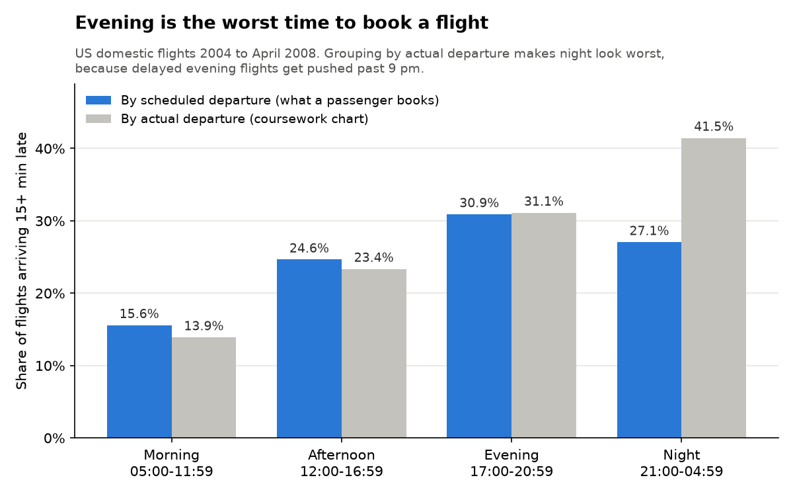

# ✈️ Flight Delay Prediction

[](https://github.com/mattimathics/Flight-Delay-Prediction/actions/workflows/tests.yml)

**Can we predict a flight delay before the plane leaves, without cheating?**

I analysed 31 million US domestic flights (2004–2008) in Python, R and SQL. My first model looked almost perfect, but it was secretly being given the answer. I found the leak, rebuilt the model honestly, and kept both results side by side.

**[Try the live demo: pick a real 2008 flight and see what the model predicted](https://mattimathics.github.io/Flight-Delay-Prediction/)**

## Key results

| | Result |
|---|---|
| First (leaky) model | AUC 0.93–0.98. Too good to be true: it used the departure delay, which is only known after take-off. |
| Honest model, weeks ahead | AUC **0.654** from the timetable alone, beating a simple route-history benchmark (0.589). |
| Honest model, 2 hours before departure | AUC **0.765**, or **0.793** with airport weather. |
| What that buys an airline | 2 hours out, the riskiest 10% of flights are late **73.5%** of the time, against 25.2% of all 2008 flights. |
| Best time to fly | The morning: 15.6% of flights are late, against 30.9% in the evening. |

**AUC** measures how well a model ranks late flights above on-time ones: 0.5 is a coin flip, 1.0 is perfect. A flight counts as **late** if it arrives 15+ minutes behind schedule (the FAA definition).



## The leakage story

1. **Too good to be true.** For my coursework I compared six models, from logistic regression to gradient boosting. All scored AUC 0.93–0.98, and the simplest did as well as the most complex. That was the clue.
2. **Why.** The models were given the departure delay, taxi times and time in the air. None of these is known until the plane has left. A flight that leaves 40 minutes late will almost certainly arrive late. This is **target leakage**: giving a model information it would not have when it makes the prediction.
3. **The fix.** I rebuilt the model with only what is known before departure: timetable, route, airline, distance, date and plane age. It learns from 2004–2007 and is tested on 2008, as a real forecast would be.
4. **Then I improved it honestly.** I moved the prediction to 2 hours before departure and added only what has already happened by then, such as the plane's previous flight. An automated test changes everything after the cutoff and checks that no feature moves.

| Model | Predicts | AUC | Riskiest 10% that were late | Share of all late flights caught |
|---|---|---|---|---|
| Benchmark: route's past delay rate | Weeks ahead | 0.589 | 35.1% | 13.9% |
| Timetable only | Weeks ahead | 0.654 | 45.3% | 18.0% |
| Uses what's known that day | 4 hours before | 0.707 | 59.4% | 23.6% |
| Uses what's known that day | 2 hours before | **0.765** | **73.5%** | **29.2%** |
| Same, plus airport weather | 2 hours before | 0.793 | 77.7% | 30.9% |
| Uses what's known that day | 1 hour before | 0.807 | 86.2% | 34.2% |
| Leaky (told the departure delay) | After take-off | 0.998 | 100% | 39.7% |

Every model except the benchmark is gradient boosting, trained on 8,477,419 flights (a 30% sample of 2004–2007) and tested on 695,298 flights (January–April 2008). The leaky row is the same rebuild given the departure delay, taxi and air time back.

**The lesson:** always ask *when* each piece of information becomes known. A near-perfect score on a messy real-world problem is a warning sign, not a win.

## What makes flights late

| Question | Answer |
|---|---|
| Time of day | Mornings are best (15.6% late), evenings worst (30.9%). |
| Day of week | Friday is worst (25.9%), Saturday best (18.5%). |
| Season | Winter (25.4%) and summer (25.0%) are worst, autumn best (19.2%). |
| Plane age | Little difference: planes over 20 years old are late 23.9% of the time, against 22.6% for planes up to 10 years old. |
| Knock-on delays | 27% of late arrivals (2.8 million of 10.3 million) made the same plane's next flight late. |
| Number of flights | Fell across the US from December 2007. |
| What the model relies on | The departure and arrival airports most, then the departure hour. Plane age barely matters. |

Rates are grouped by **scheduled** departure time, the time a passenger sees when booking. These are comparisons, not causes.

## How an airline could use it

- **Weeks ahead (timetable model):** give the riskiest scheduled flights more slack, such as a longer turnaround. Their riskiest 10% are late 45% of the time.
- **On the day (2-hour model):** each morning, send standby crews, spare gates and rebooking staff to the 10% of flights most likely to be late.
- **How many to flag:** the 2-hour model's percentages are, on average, within 1.2 points of what really happened, so the alert level can be set straight from costs: cost of acting ÷ cost of a missed delay.

## Limitations

- **Old data.** It ends in April 2008, so the model needs retraining before it is used today.
- **Winter and spring only.** The test covers January–April 2008, so summer thunderstorms are untested.
- **Only flights that arrived.** Cancelled and diverted flights are left out.
- **A 30% sample**, the most my laptop's memory could hold. Going from 10% to 30% added only 0.004 AUC, so all the data would probably add very little.

**[Full results →](RESULTS.md)** every step with its tables and charts, the design choices and why I made them, and the full list of limitations.

## Run it

1. Download the data into `data/` (see [data/README.md](data/README.md)).
2. Install and build the database:
   ```bash
   pip install -r requirements.txt                          # exact versions used (Python 3.13)
   jupyter notebook notebooks/flight_delay_analysis.ipynb   # builds data/Fly.db
   ```
3. Run any script in `src/`, for example `python src/model_v4.py --db data/Fly.db`. Each uses a 1% sample by default, which takes minutes. The numbers above come from `--pct 30`, which needs about 15 GB of memory. [RESULTS.md](RESULTS.md#run-every-script) lists every script.
4. Tests run on a tiny fake database, so no data is needed: `pip install -r requirements-dev.txt && pytest`
5. R version: open `r/flight_delay_analysis.Rmd` in RStudio and knit.

| Folder | What's in it |
|---|---|
| `src/` | The models and analysis scripts |
| `notebooks/`, `r/` | The original analysis in Python and R |
| `results/` | The tables behind every number in this README |
| `docs/` | The live demo web page |
| `tests/` | Automated checks, including the no-leakage test |

**Tools:** SQLite, Python (pandas, scikit-learn, Matplotlib), R (dplyr, ggplot2, mlr3).

## About

Built by **Matthew James Tan** for the BSc Data Science and Business Analytics (University of London, SIM), and improved afterwards. [LinkedIn](https://www.linkedin.com/in/matthew-james-tan-461b98398) · [GitHub](https://github.com/mattimathics)

MIT licence. Data: [ASA Data Expo 2009](https://doi.org/10.7910/DVN/HG7NV7), Harvard Dataverse.
