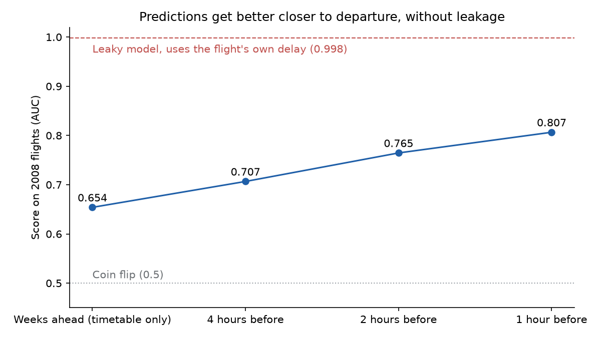

# ✈️ Flight Delay Analysis and Prediction

[](https://github.com/mattimathics/Flight-Delay-Prediction/actions/workflows/tests.yml)

**What makes US flights late, and can we predict a delay before the plane leaves?**

I analysed 31 million US domestic flights (2004–2008) in Python, R and SQL. Then I built a model to predict delays. My first model looked almost perfect, but it was cheating: it used information that only exists after take-off. I found the problem, rebuilt the model honestly, and kept both results side by side.

**[Try it: pick a real 2008 flight and see what the model predicted](https://mattimathics.github.io/Flight-Delay-Prediction/)**

## In 30 seconds

- **Data:** 31 million flights, loaded into a SQLite database.
- **Best time to fly:** the morning. 15.6% of flights scheduled to leave in the morning are late, against 30.9% in the evening.
- **The model:** the first version scored 0.93–0.98 AUC, which was too good to be true. It used the departure delay to predict the arrival delay. With only the timetable, the honest score is **0.654**, from a model that learned from 8.5 million flights. Predicting 2 hours before departure, using only what has already happened that day, it rises to **0.765**.
- **What it's good for:** 2 hours out, the 10% of flights the model rates riskiest are late 73% of the time, against 25.2% for all 2008 flights. An airline could send standby crews and spare gates to that list.
- **The lesson:** always check *when* each piece of information becomes known.


## The questions

Using the [ASA Data Expo 2009](https://doi.org/10.7910/DVN/HG7NV7) flight data, I asked five questions:

1. When is the best time of day, day of week and time of year to fly?
2. Do older planes have more delays?
3. How has the number of flights between states changed?
4. Does one late flight make the same plane's next flight late?
5. Can a model predict whether a flight will arrive 15+ minutes late?

## What I found

| Question | Answer |
|---|---|
| Time of day | Mornings are best (15.6% late). Evenings are worst (30.9%).* |
| Day and season | Friday is the worst day (25.9%) and Saturday the best (18.5%). Winter (25.4%) and summer (25.0%) are the worst seasons, and autumn the best (19.2%). |
| Plane age | Age makes little difference: planes over 20 years old are late 23.9% of the time, against 22.6% for planes up to 10 years old.† |
| Number of flights | Flights started falling across the US in December 2007. |
| Knock-on delays | By following each plane's tail number, I traced how a late arrival makes the same plane's next departure late. |
| Prediction | See the model section below. |

\*These rates group flights by their **scheduled** departure time, the time a passenger sees when booking. My coursework chart grouped them by **actual** departure time instead, which made night look worst (41.5%). That was misleading: an evening flight that runs late and leaves after 9 pm gets counted as a "night" flight, so night collects other slots' delays. The chart at the top shows both groupings side by side.

| Time of day | Late, grouped by scheduled departure | Late, grouped by actual departure | Flights (by scheduled time) |
|---|---|---|---|
| Morning (05:00–11:59) | 15.6% | 13.9% | 12,365,755 |
| Afternoon (12:00–16:59) | 24.6% | 23.4% | 9,621,903 |
| Evening (17:00–20:59) | **30.9%** | 31.1% | 6,953,325 |
| Night (21:00–04:59) | 27.1% | 41.5% | 1,637,795 |

These come from all 30,578,778 flights that arrived (cancelled and diverted flights have no arrival delay, so they are left out). `src/time_of_day.py` recomputes them and redraws the chart.

†Plane age is the flight's year minus the year the plane was built. A quarter of flights (7,658,924) have no usable build year, either because the plane is missing from the plane data or because its year is blank or 0, so they are left out of the age groups. My coursework version counted the planes with year 0 as about 2,000 years old, which put them in the "old" group. The gap that remains is also a plain comparison: older planes may fly for different airlines or routes, so it doesn't show that age itself causes delays.

The day, season and plane-age numbers come from `src/findings.py`, which counts every arrived flight, saves the tables to `results/` and redraws these charts:

| Day of week | Season | Plane age |
|---|---|---|
|  |  |  |

## The model, and the mistake I found

**Step 1: the first model looked too good.** For my coursework, I compared six models:

- logistic regression
- penalised logistic regression
- decision tree
- random forest
- gradient boosting
- support vector machine

I tuned them with grid search in scikit-learn and compared them with cross-validation in R (mlr3). Every one scored an AUC between 0.93 and 0.98.


**Step 2: why it was too good.** The models were given the departure delay, taxi times and time in the air. None of these is known until the plane has left. If a flight leaves 40 minutes late, it will almost certainly arrive late, so the model was partly being told the answer. This is called **target leakage**. One clue: even the simplest model did as well as the most complex one.

**Step 3: the honest version** (`src/model_v2.py`). I rebuilt the model using only what is known before departure:

- scheduled departure and arrival times
- route, airline and distance
- month and day of the week
- the age of the plane

It learns from 2004–2007 flights and is tested on 2008 flights, as a real forecast would be. The leaky version is kept alongside so you can see the gap.

| Model | Information used | AUC, 1% sample | AUC, 10% sample | AUC, 30% sample |
|---|---|---|---|---|
| Logistic regression | Before departure only | 0.628 | 0.628 | 0.629 |
| Gradient boosting | Before departure only | 0.642 | 0.650 | **0.654** |
| Gradient boosting | Plus departure delay, taxi and air time (leaky) | 0.996 | 0.998 | 0.998 |
| | Flights learned from (2004–2007) | 282,717 | 2,824,284 | 8,477,419 |
| | Flights tested on (2008) | 23,363 | 232,019 | 695,298 |

The 2008 data only covers January to April. Each sample is a fixed share of all flights, picked the same way every time (`python src/model_v2.py --pct 30`). All three runs are saved in `results/model_comparison_v2_by_sample.csv`. 30% is the largest sample that fits in my laptop's memory: it peaked at 14.7 GB and took about 8 minutes. The chart below is from the 30% run.

**More data helped gradient boosting a little (0.642 → 0.654) and logistic regression not at all.** Gradient boosting can pick up patterns for rare airports and routes, and more flights give it enough examples of each. Logistic regression gives each airport, airline and hour one fixed weight, and 1% of the data was already enough to set those. (An earlier version of this README said 0.627, 0.641 and 0.997. Those came from a random sample that could not be repeated.)

Steps 4 to 8 below use the same 30% sample and the same 695,298 test flights.


**What this means.** Predicting a delay from the timetable alone is hard. A score of about 0.65 is a modest but real signal. Adding the departure delay pushes it to 0.998, and that jump is the leakage. It is why the coursework scores were too good to be true.

**Step 4: can the honest model do better?** (`src/model_v3.py`). I added three more things an airline knows before departure:

- **Airport busyness:** how many flights are scheduled to leave the origin airport in the same hour of the same day, and how many are scheduled to land at the destination. A busy hour means queues on the runway.
- **Route history:** the share of flights on the same route that were late in 2004–2007. Only the training years are used, so the 2008 test flights never feed into it. Routes with few flights are pulled towards the overall average, so a route flown 3 times can't get an extreme rate.

I also compared every model against a simple **benchmark**: no model at all, just rank flights by their route's past delay rate. A model is only worth having if it beats that.

| Method | Score on 2008 flights (AUC) | Late, among the riskiest 10% | Share of all late flights caught |
|---|---|---|---|
| Benchmark: route's past delay rate | 0.589 | 35.1% | 13.9% |
| v2 gradient boosting | 0.654 | 45.3% | 18.0% |
| v2 + airport busyness | 0.655 | 45.3% | 18.0% |
| v2 + route history | 0.653 | 45.3% | 18.0% |
| v3 gradient boosting (both added) | 0.654 | 45.3% | 18.0% |
| v3 logistic regression (both added) | 0.633 | 42.0% | 16.7% |

Same 30% sample and same 2008 test flights as Step 3. Across all 2008 test flights, 25.2% were late.


**What this means.**

- **The model beats the benchmark clearly.** Its riskiest 10% of flights are late 45% of the time: 1.8 times the average. Ranking by route history alone gives 35%.
- **The new features did not help gradient boosting.** It already knows the airport, route, airline and hour, so it had worked out most of this for itself. They did help the simpler logistic regression (0.629 → 0.633).
- **More data helps a little, not a lot.** Gradient boosting scored 0.642 on the 1% sample, 0.647 on 5% and 0.654 on 30%.
- **The timetable alone has a ceiling of about 0.65.** Even 8.5 million training flights only reach 0.654 (Step 3). Most delays come from things that happen on the day, like weather and late incoming planes. Getting past that ceiling means predicting closer to departure, using what has already gone wrong that day.

**Step 5: predicting 2 hours before departure** (`src/model_v4.py`). An airline re-plans crews and gates a couple of hours ahead, and by then it knows more. I moved the prediction to 2 hours before the scheduled departure and added only what is known at that moment:

- **The airport's earlier delays:** of the flights at the same airport scheduled to leave 2¼ to 5 hours before ours, the share that left 15+ minutes late. Stopping at 2¼ hours matters: a flight scheduled then has either left by the 2-hour mark, or is already known to be late.
- **The plane's turnaround:** the scheduled gap between the same plane landing here and our departure. A short gap leaves no room to catch up.
- **The plane's previous flight:** how late it took off, *only if it had taken off by the 2-hour mark*. Otherwise it is left blank, because we wouldn't know yet. Its take-off time is worked out as landing time minus flight time, so both are on our airport's clock.

This keeps the leakage rule from Step 2: nothing that happens after the 2-hour mark is used. An automated test changes everything after the cutoff (including the flight's own delay) and checks that none of these features move.

| Method | Score on 2008 flights (AUC) | Late, among the riskiest 10% | Share of all late flights caught |
|---|---|---|---|
| Benchmark: route's past delay rate | 0.589 | 35.1% | 13.9% |
| v3 gradient boosting (timetable only) | 0.654 | 45.3% | 18.0% |
| + airport's earlier delays only | 0.698 | 58.0% | 23.0% |
| + plane's previous flight only | 0.745 | 68.5% | 27.2% |
| v4 logistic regression (2 hours before) | 0.691 | 58.5% | 23.2% |
| v4 gradient boosting (2 hours before) | **0.765** | **73.5%** | **29.2%** |

Same 30% sample and same 2008 test flights as Steps 3 and 4. The airport's earlier delays are known for 84.6% of test flights, the turnaround for 77.0%, and the previous flight's delay for 53.2%. On the 1% sample this model scored 0.751, so more data added about 0.014. Early-morning flights, for example, have nothing earlier that day to learn from.


**What this means.**

- **What happened earlier that day matters more than anything in the timetable.** The plane's previous flight alone lifts the score from 0.654 to 0.745.
- **2 hours out, the riskiest 10% are late 73% of the time**, 2.9 times the average. That list holds 29% of all late flights.
- **This is still not leakage.** The leaky model scored 0.998 because it was given the flight's own delay. This one only sees other flights, and only what had already happened 2 hours before.
- **The two models answer different questions.** The timetable model (0.654) works weeks ahead, for planning schedules. The 2-hour model (0.765) works on the day, for operations.

**Step 6: can its percentages be trusted, and when should it raise an alert?** (`src/check_probabilities.py`). A ranking is useful, but an airline acting on "70% chance of delay" needs that 70% to be true. I grouped the 2008 test flights by the 2-hour model's predicted chance and checked how many in each group were really late.


| Predicted chance | Flights | Model's average prediction | Really late |
|---|---|---|---|
| 0–10% | 159,626 | 6.9% | 7.9% |
| 10–20% | 243,545 | 14.5% | 16.2% |
| 20–30% | 119,551 | 24.4% | 25.8% |
| 30–40% | 59,694 | 34.5% | 35.6% |
| 40–50% | 35,537 | 44.6% | 44.9% |
| 50–60% | 24,187 | 54.7% | 54.9% |
| 60–70% | 17,338 | 64.8% | 64.9% |
| 70–80% | 13,946 | 74.8% | 76.4% |
| 80–90% | 11,238 | 84.9% | 86.5% |
| 90–100% | 10,636 | 95.1% | 96.0% |

- **The percentages can be trusted.** On average, a group's prediction is 1.2 points away from what really happened, so no correction is needed.
- **Where they are off, they run a little low.** The model expects 24.0% of 2008 flights to be late; 25.2% were. Delays became more common every year (20.4% in 2004, 24.8% in 2007), and a model trained on the past can't know that 2008 would be worse still.

**Choosing an alert level.** It is worth acting on a flight when the expected cost of a delay is bigger than the cost of acting: chance of delay × cost of a missed delay > cost of acting. So the alert level is simply **cost of acting ÷ cost of a missed delay**. This only works because the percentages are trustworthy.

| Alert if chance is at least | Flights flagged | Late, among flagged | Share of all late flights caught |
|---|---|---|---|
| 20% | 42.0% | 42.2% | 70.3% |
| 25% | 31.8% | 48.1% | 60.7% |
| 30% | 24.8% | 53.5% | 52.7% |
| 40% | 16.2% | 63.0% | 40.6% |
| 50% | 11.1% | 71.2% | 31.5% |
| 70% | 5.2% | 85.4% | 17.5% |

For example, if a missed delay costs four times as much as acting (an illustration, not a real airline figure), the alert level is 1 ÷ 4 = 25%. The model would flag about a third of flights and catch 61% of late ones. If acting is expensive, raise the level: at 70%, it flags 5.2% of flights and 85% of them are really late. `--cost-of-acting` and `--cost-of-missed-delay` let you plug in real costs.

**Step 7: how much does it help to wait?** (`src/prediction_time.py`). I rebuilt the same model with the cutoff at 4 hours, 2 hours and 1 hour before departure. At each cutoff it sees only what had happened by then, so later cutoffs know more.



| Prediction made | Score on 2008 flights (AUC) | Late, among the riskiest 10% | Share of all late flights caught | Plane's previous take-off known |
|---|---|---|---|---|
| Weeks ahead (timetable only) | 0.654 | 45.3% | 18.0% | – |
| 4 hours before | 0.707 | 59.4% | 23.6% | 12.6% of flights |
| 2 hours before | 0.765 | 73.5% | 29.2% | 53.2% |
| 1 hour before | 0.807 | 86.2% | 34.2% | 74.1% |
| After take-off (leaky) | 0.998 | 100% | 39.7% | – |

- **Every hour closer adds accuracy**, mostly because more incoming planes have already taken off. At 4 hours, 12.6% of flights have that information. At 1 hour, 74.1% do.
- **This is the trade-off an airline faces:** wait longer and the warning is more accurate, but there is less time to act on it. 1 hour out, 86% of flagged flights are late, but there may be no spare crew left to call.
- **Even 1 hour out, the honest model (0.807) is far from the leaky one (0.998).** That gap is what the leaky model was getting by being told the answer.

**Step 8: adding the weather** (`src/download_weather.py`, `src/model_weather.py`). I downloaded the hourly weather reports that US airports publish, for 2004 to April 2008, from the [Iowa Environmental Mesonet](https://mesonet.agron.iastate.edu/request/download.phtml) (Iowa State University). That covers 96 of the 100 busiest airports (232 MB); the other four aren't in the archive. For each flight, the model sees the **last report issued before the 2-hour mark** at both the departure and arrival airports:

- visibility, wind speed, gusts, rain in the last hour and the height of the lowest cloud
- whether a thunderstorm, snow or fog was reported

A report more than 3 hours old is treated as unknown. All times are converted to one world clock (UTC). Without that, a New York to Los Angeles flight would have read Los Angeles weather from up to 3 hours after the cutoff, because Los Angeles clocks are 3 hours behind. My first version made exactly that mistake; a test now checks it.

| Method | Score on 2008 flights (AUC) | Late, among the riskiest 10% | Share of all late flights caught |
|---|---|---|---|
| Timetable only (weeks ahead) | 0.654 | 45.3% | 18.0% |
| Timetable + weather, 2 hours before | 0.717 | 62.3% | 24.7% |
| 2 hours before | 0.765 | 73.5% | 29.2% |
| 2 hours before + weather | **0.793** | **77.7%** | **30.9%** |

Weather is known at the departure airport for 90.7% of test flights, and at the arrival airport for 88.2%.

- **Weather helps, and it helps most when little else is known.** Adding only the weather to the timetable features lifts the score from 0.654 to 0.717, but adding it to the full 2-hour model only lifts it from 0.765 to 0.793. Note that the 0.717 model is a 2-hour prediction too: weather on the day isn't known weeks ahead, so it doesn't improve the weeks-ahead model. The airport's earlier delays already reflect a bad-weather day, so some of the information was already there.
- **The arrival airport matters too.** A storm at the destination delays the arrival even if the departure is on time.

## Terms used

- **AUC:** how well a model ranks late flights above on-time ones. 0.5 is a coin flip and 1.0 is perfect.
- **Target leakage:** giving a model information it would not have at the time it makes its prediction.
- **Delayed:** arriving 15 or more minutes late. This is the US Federal Aviation Administration (FAA) definition.
- **Calibration:** whether a model's percentages match reality. If it says 30% for a group of flights, about 30% should be late.
- **Cutoff:** the moment the prediction is made. Anything that happens after it can't be used.
- **Time-based split:** training on earlier years and testing on a later year, so the model never sees the future.
- **Benchmark:** the simplest sensible way to do the job without a model. Here, ranking flights by how often their route was late in the past.

## Key choices, and why

- **A database instead of loading everything into memory.** 31 million rows don't fit comfortably in a laptop's memory. A SQLite database with indexes lets each query pull only the rows it needs.
- **Delay rates, not counts.** Busy times naturally have more delays, so every comparison uses the *share* of flights that were late.
- **The FAA definition of late:** 15+ minutes after schedule.
- **Test on a later year.** A random split would let the model learn from days it is later tested on. Training on 2004–2007 and testing on 2008 avoids that.
- **Always compare against a benchmark.** A score of 0.65 means little on its own. Beating the route's past delay rate (0.589) shows the model learned something history alone doesn't give you.
- **Report a result in business terms.** "The riskiest 10% are late 73% of the time" is something an operations manager can act on. An AUC is not.
- **Repeatable samples.** The model always picks the same sample of flights for a given setting, so anyone rerunning it gets the same numbers.

## Tools

- **Data:** SQLite (via `sqlite3` in Python and `DBI`/`RSQLite` in R), indexed on tail number, date and route.
- **Python:** pandas, NumPy, statsmodels, scikit-learn, Matplotlib, seaborn, Plotly.
- **R:** dplyr, ggplot2, mlr3, glmnet, ranger, XGBoost.

## What's in this repo

```
├── notebooks/flight_delay_analysis.ipynb   # Python analysis (questions 1–5), with outputs
├── r/flight_delay_analysis.Rmd             # The same analysis in R
├── src/model_v2.py                         # The honest model (before-departure information only)
├── src/model_v3.py                         # Adds airport busyness, route history, a benchmark and the riskiest-10% check
├── src/model_v4.py                         # Predicts 2 hours before departure, using delays already known that day
├── src/check_probabilities.py              # Checks the 2-hour model's percentages and picks an alert level from costs
├── src/prediction_time.py                  # Same model at 4, 2 and 1 hours before departure
├── src/build_web_page.py                   # Saves 2008 test flights' predictions for the web page
├── src/download_weather.py                 # Downloads hourly airport weather (2004–Apr 2008) for the busiest airports
├── src/model_weather.py                    # Adds the last weather report before the 2-hour mark
├── docs/                                   # The web page (index.html) and its data (flights.json)
├── src/time_of_day.py                      # Delay rate by scheduled vs actual departure time (the top chart)
├── src/findings.py                         # Delay rate by day, season and plane age (writes results/)
├── results/                                # The tables behind the README's numbers
├── tests/                                  # Automated checks that run on fake data
├── data/README.md                          # How to download the data
├── images/                                 # Charts used in this README
└── requirements.txt                        # Exact Python package versions (+ requirements-dev.txt for tests)
```

## How to run it

1. Download the data into `data/` (see [data/README.md](data/README.md)).
2. Python:
   ```bash
   pip install -r requirements.txt
   jupyter notebook notebooks/flight_delay_analysis.ipynb   # builds data/Fly.db
   python src/model_v2.py --db data/Fly.db                  # same --pct and --seed give the same sample
   python src/model_v3.py --db data/Fly.db                  # stronger features, benchmark and riskiest-10% chart
   python src/model_v4.py --db data/Fly.db                  # 2 hours before departure
   python src/check_probabilities.py --db data/Fly.db       # can the percentages be trusted? which alert level?
   python src/prediction_time.py --db data/Fly.db           # 4, 2 and 1 hours before departure
   python src/build_web_page.py --db data/Fly.db            # rebuilds docs/flights.json (adds weather if data/weather exists)
   python src/download_weather.py --db data/Fly.db          # about 230 MB into data/weather (needs curl)
   python src/model_weather.py --db data/Fly.db             # 2-hour model with and without weather
   python src/time_of_day.py --db data/Fly.db               # redraws images/delay_rate_by_time_of_day.png
   python src/findings.py --db data/Fly.db                  # day, season and plane-age tables and charts
   ```
   Every script uses a 1% sample by default, which runs in minutes. The README's numbers come from `--pct 30` (8.5 million training flights), which takes several hours for the 2-hour scripts and needs about 15 GB of memory. The web page was built with `--pct 30 --show-pct 1`: models trained on 30%, with 1% of the test flights listed so the file stays small.
3. R: open `r/flight_delay_analysis.Rmd` in RStudio and knit.
4. Tests (no data needed, as they build a tiny fake database):
   ```bash
   pip install -r requirements-dev.txt
   pytest
   ```

## What I learned

- **Ask when each piece of information becomes known.** A near-perfect score on a messy real-world problem is a warning sign, not a win.
- **Build indexes for the queries you will run.** Tracing knock-on delays meant matching 31 million flights against each other by plane and date, so those are the columns I indexed.
- **How you group data can change the answer**, as with actual vs scheduled departure time.
- **Doing the same work in R and Python** showed me how their machine learning tools differ in setup, tuning and testing.

## What I'd do next

- Retrain on recent months, since delays became more common every year.

## About

Built by **Matthew James Tan** for the BSc Data Science and Business Analytics (University of London, SIM), and improved afterwards. [LinkedIn](https://www.linkedin.com/in/matthew-james-tan-461b98398) · [GitHub](https://github.com/mattimathics)

## License

MIT. Data: ASA Data Expo 2009, Harvard Dataverse.
