# Full results

The detail behind the [README](README.md). Every number here comes from a script in `src/` and a table in `results/`.

**Contents:** [What makes flights late](#what-makes-flights-late) · [The model, step by step](#the-model-step-by-step) · [The timetable model in practice](#the-timetable-model-in-practice) · [What drives the predictions](#what-drives-the-predictions) · [Key choices, and why](#key-choices-and-why) · [Limitations](#limitations) · [Run every script](#run-every-script) · [Terms used](#terms-used)

## What makes flights late

Data: [ASA Data Expo 2009](https://doi.org/10.7910/DVN/HG7NV7), 31 million US domestic flights, 2004–2008. I asked five questions:

1. When is the best time of day, day of week and time of year to fly?
2. Do older planes have more delays?
3. How has the number of flights between states changed?
4. Does one late flight make the same plane's next flight late?
5. Can a model predict whether a flight will arrive 15+ minutes late?

| Question | Answer |
|---|---|
| Time of day | Mornings are best (15.6% late). Evenings are worst (30.9%). |
| Day and season | Friday is worst (25.9%), Saturday best (18.5%). Winter (25.4%) and summer (25.0%) are the worst seasons, autumn the best (19.2%). |
| Plane age | Little difference: planes over 20 years old are late 23.9% of the time, against 22.6% for planes up to 10 years old. |
| Number of flights | Flights started falling across the US in December 2007. |
| Knock-on delays | Following each plane's tail number to its next flight that day: 27% of late arrivals (2.8 million of 10.3 million) made the next flight leave and arrive late, with the airline blaming the late incoming plane. |
| Prediction | See [the model, step by step](#the-model-step-by-step). |

### Time of day: scheduled vs actual departure

| Time of day | Late, by scheduled departure | Late, by actual departure | Flights (by scheduled time) |
|---|---|---|---|
| Morning (05:00–11:59) | 15.6% | 13.9% | 12,365,755 |
| Afternoon (12:00–16:59) | 24.6% | 23.4% | 9,621,903 |
| Evening (17:00–20:59) | **30.9%** | 31.1% | 6,953,325 |
| Night (21:00–04:59) | 27.1% | 41.5% | 1,637,795 |

- **I group by scheduled time**, the time a passenger sees when booking.
- **My coursework grouped by actual time**, which made night look worst (41.5%). That was misleading: an evening flight that leaves late, after 9 pm, gets counted as "night", so night collects other slots' delays.
- **Source:** all 30,578,778 flights that arrived (cancelled and diverted flights have no arrival delay). `src/time_of_day.py` recomputes them and redraws the chart.

### Day, season and plane age

| Day of week | Season | Plane age |
|---|---|---|
| 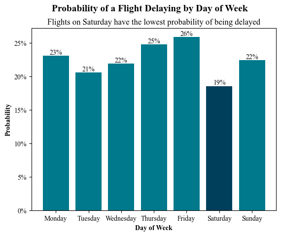 | 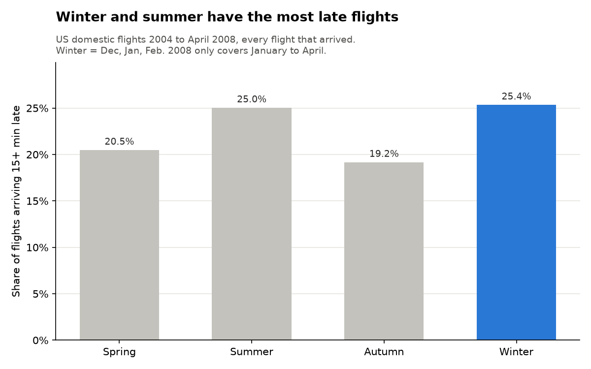 | 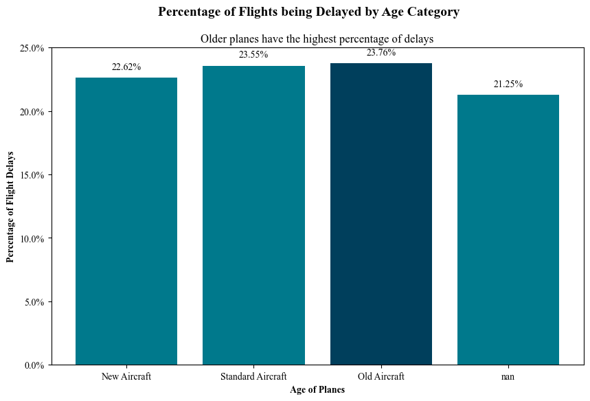 |

- **Plane age** = the flight's year minus the year the plane was built.
- **A quarter of flights (7,658,924) have no usable build year**: the plane is missing from the plane data, or its year is blank or 0. They are left out. My coursework counted year-0 planes as about 2,000 years old, which put them in the "old" group.
- **The small gap is not a cause.** Older planes may fly for different airlines or routes.
- **Source:** `src/findings.py` counts every arrived flight, saves the tables to `results/` and redraws these charts.

## The model, step by step

Steps 3 to 8 all train on 2004–2007 and test on the same 695,298 flights from January–April 2008 (the data ends there). 25.2% of those test flights were late.

### Step 1: the first model looked too good

For my coursework I compared six models: logistic regression, penalised logistic regression, decision tree, random forest, gradient boosting and a support vector machine. I tuned them with grid search in scikit-learn and compared them with cross-validation in R (mlr3). **Every one scored an AUC between 0.93 and 0.98.**

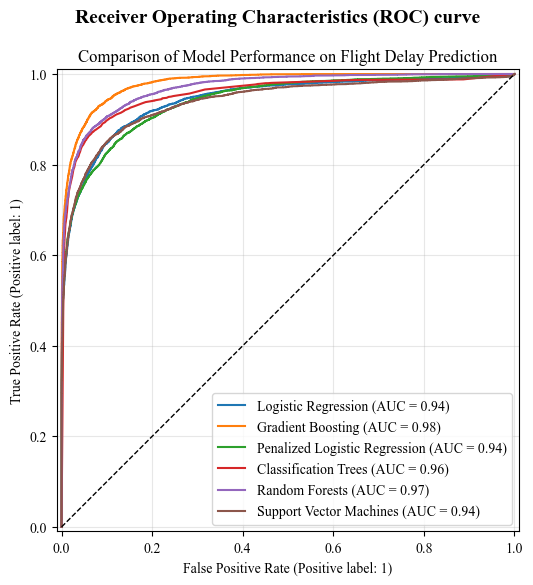

### Step 2: why it was too good

- The models were given the **departure delay, taxi times and time in the air**. None is known until the plane has left.
- A flight that leaves 40 minutes late will almost certainly arrive late, so the model was partly being told the answer. This is **target leakage**.
- **The clue:** even the simplest model did as well as the most complex one.

### Step 3: the honest version (`src/model_v2.py`)

Only what is known before departure: scheduled departure and arrival times, route, airline, distance, month, day of the week and plane age. The leaky version is kept alongside to show the gap.

| Model | Information used | AUC, 1% sample | AUC, 10% sample | AUC, 30% sample |
|---|---|---|---|---|
| Logistic regression | Before departure only | 0.628 | 0.628 | 0.629 |
| Gradient boosting | Before departure only | 0.642 | 0.650 | **0.654** |
| Gradient boosting | Plus departure delay, taxi and air time (leaky) | 0.996 | 0.998 | 0.998 |
| | Flights learned from (2004–2007) | 282,717 | 2,824,284 | 8,477,419 |
| | Flights tested on (2008) | 23,363 | 232,019 | 695,298 |

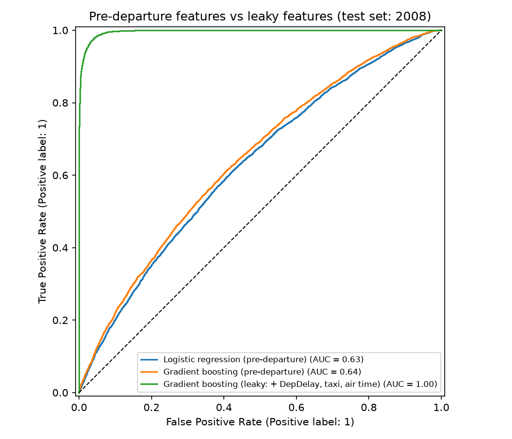

- **The timetable alone gives a modest but real signal (about 0.65).** Adding the departure delay jumps it to 0.998. That jump is the leakage.
- **More data helped gradient boosting a little (0.642 → 0.654) and logistic regression not at all.** Gradient boosting can learn patterns for rare airports and routes, given enough examples. Logistic regression gives each airport, airline and hour one fixed weight, and 1% of the data already set those.
- **How the samples work:** each is a fixed share of all flights, picked the same way every time (`python src/model_v2.py --pct 30`). All three runs are in `results/model_comparison_v2_by_sample.csv`. The 30% run peaked at 14.7 GB of memory and took about 8 minutes.
- **Earlier numbers retired:** an older version of this README said 0.627, 0.641 and 0.997. Those came from a random sample that could not be repeated.

### Step 4: can the honest model do better? (`src/model_v3.py`)

I added two things an airline knows before departure:

- **Airport busyness:** flights scheduled to leave the origin, and to land at the destination, in the same hour of the same day. Busy hours mean runway queues.
- **Route history:** the share of the route's 2004–2007 flights that were late (training years only, so 2008 never feeds in). Routes with few flights are pulled towards the overall average, so a route flown 3 times can't get an extreme rate.

I also compared against a **benchmark**: no model, just rank flights by their route's past delay rate.

| Method | AUC | Late, among the riskiest 10% | Share of all late flights caught |
|---|---|---|---|
| Benchmark: route's past delay rate | 0.589 | 35.1% | 13.9% |
| v2 gradient boosting | 0.654 | 45.3% | 18.0% |
| v2 + airport busyness | 0.655 | 45.3% | 18.0% |
| v2 + route history | 0.653 | 45.3% | 18.0% |
| v3 gradient boosting (both added) | 0.654 | 45.3% | 18.0% |
| v3 logistic regression (both added) | 0.633 | 42.0% | 16.7% |

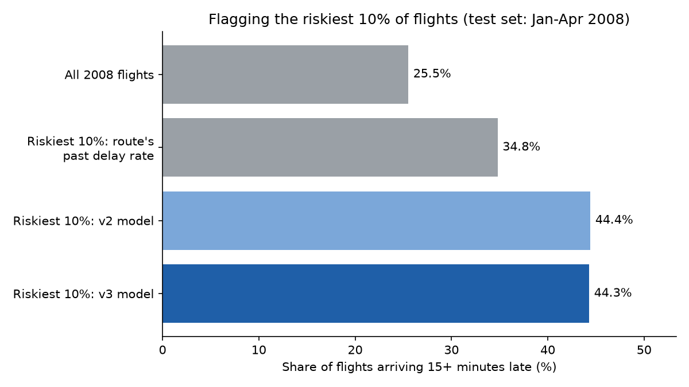

- **The model clearly beats the benchmark.** Its riskiest 10% are late 45% of the time, 1.8 times the average. Route history alone gives 35%.
- **The new features didn't help gradient boosting.** It already knows the airport, route, airline and hour. They did help logistic regression (0.629 → 0.633).
- **The timetable has a ceiling of about 0.65.** Most delays come from things on the day, like weather and late incoming planes. Getting past it means predicting closer to departure.

### Step 5: predicting 2 hours before departure (`src/model_v4.py`)

Airlines re-plan crews and gates a couple of hours ahead, and by then they know more. I added only what is known at the 2-hour mark:

- **The airport's earlier delays:** of the flights at the same airport scheduled to leave 2¼ to 5 hours before ours, the share that left 15+ minutes late. Stopping at 2¼ hours means each of those flights has either left, or is already known to be late.
- **The plane's turnaround:** the scheduled gap between the same plane landing here and our departure. A short gap leaves no room to catch up.
- **The plane's previous flight:** how late it took off, *only if it had taken off by the 2-hour mark*; otherwise blank. Take-off time is landing time minus flight time, so both are on our airport's clock.

**Nothing after the 2-hour mark is used.** An automated test changes everything after the cutoff (including the flight's own delay) and checks that none of these features move.

| Method | AUC | Late, among the riskiest 10% | Share of all late flights caught |
|---|---|---|---|
| Benchmark: route's past delay rate | 0.589 | 35.1% | 13.9% |
| v3 gradient boosting (timetable only) | 0.654 | 45.3% | 18.0% |
| + airport's earlier delays only | 0.698 | 58.0% | 23.0% |
| + plane's previous flight only | 0.745 | 68.5% | 27.2% |
| v4 logistic regression (2 hours before) | 0.691 | 58.5% | 23.2% |
| v4 gradient boosting (2 hours before) | **0.765** | **73.5%** | **29.2%** |

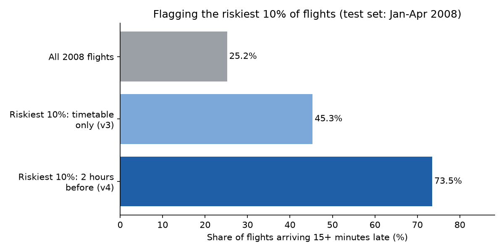

- **What happened earlier that day beats anything in the timetable.** The plane's previous flight alone lifts the score from 0.654 to 0.745.
- **The riskiest 10% are late 73% of the time**, 2.9 times the average. That list holds 29% of all late flights.
- **Still not leakage.** The leaky model was given the flight's own delay. This one only sees other flights, and only what had happened 2 hours before.
- **Two models, two jobs.** The timetable model (0.654) works weeks ahead, for planning. The 2-hour model (0.765) works on the day, for operations.
- **Coverage:** the airport's earlier delays are known for 84.6% of test flights, the turnaround for 77.0%, the previous flight's delay for 53.2%. Early-morning flights, for example, have nothing earlier that day to learn from.
- **Data size:** on the 1% sample this model scored 0.751, so more data added about 0.014.

### Step 6: can its percentages be trusted? (`src/check_probabilities.py`)

An airline acting on "70% chance of delay" needs that 70% to be true. I grouped the test flights by the 2-hour model's predicted chance and checked how many were really late.

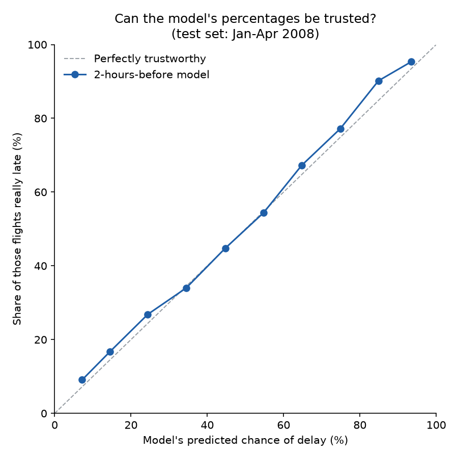

| Predicted chance | Flights | Model's average prediction | Really late |
|---|---|---|---|
| 0–10% | 159,626 | 6.9% | 7.9% |
| 10–20% | 243,545 | 14.5% | 16.2% |
| 20–30% | 119,551 | 24.4% | 25.8% |
| 30–40% | 59,694 | 34.5% | 35.6% |
| 40–50% | 35,537 | 44.6% | 44.9% |
| 50–60% | 24,187 | 54.7% | 54.9% |
| 60–70% | 17,338 | 64.8% | 64.9% |
| 70–80% | 13,946 | 74.8% | 76.4% |
| 80–90% | 11,238 | 84.9% | 86.5% |
| 90–100% | 10,636 | 95.1% | 96.0% |

- **Yes.** On average a group's prediction is 1.2 points from what really happened, so no correction is needed.
- **Where it's off, it runs a little low.** It expects 24.0% of 2008 flights to be late; 25.2% were. Delays rose every year (20.4% in 2004, 24.8% in 2007), and a model trained on the past can't know 2008 would be worse still.

**Choosing an alert level.** Act on a flight when chance of delay × cost of a missed delay > cost of acting. So the alert level is **cost of acting ÷ cost of a missed delay**. This only works because the percentages are trustworthy.

| Alert if chance is at least | Flights flagged | Late, among flagged | Share of all late flights caught |
|---|---|---|---|
| 20% | 42.0% | 42.2% | 70.3% |
| 25% | 31.8% | 48.1% | 60.7% |
| 30% | 24.8% | 53.5% | 52.7% |
| 40% | 16.2% | 63.0% | 40.6% |
| 50% | 11.1% | 71.2% | 31.5% |
| 70% | 5.2% | 85.4% | 17.5% |

Example: if a missed delay costs four times as much as acting (an illustration, not a real airline figure), the alert level is 1 ÷ 4 = 25%. That flags about a third of flights and catches 61% of late ones. If acting is expensive, raise it: at 70%, 5.2% of flights are flagged and 85% of them are really late. Plug in real costs with `--cost-of-acting` and `--cost-of-missed-delay`.

### Step 7: how much does it help to wait? (`src/prediction_time.py`)

The same model with the cutoff at 4, 2 and 1 hours before departure. Later cutoffs see more.

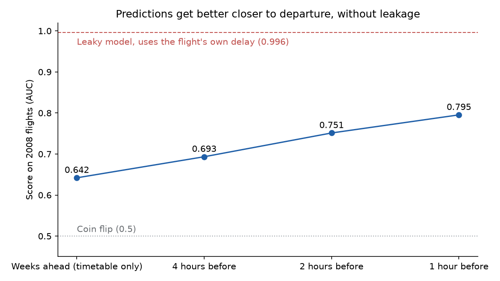

| Prediction made | AUC | Late, among the riskiest 10% | Share of all late flights caught | Plane's previous take-off known |
|---|---|---|---|---|
| Weeks ahead (timetable only) | 0.654 | 45.3% | 18.0% | – |
| 4 hours before | 0.707 | 59.4% | 23.6% | 12.6% of flights |
| 2 hours before | 0.765 | 73.5% | 29.2% | 53.2% |
| 1 hour before | 0.807 | 86.2% | 34.2% | 74.1% |
| After take-off (leaky) | 0.998 | 100% | 39.7% | – |

- **Every hour closer adds accuracy**, mostly because more incoming planes have taken off (12.6% of flights at 4 hours, 74.1% at 1 hour).
- **The trade-off:** wait longer and the warning is more accurate, but there's less time to act. 1 hour out, 86% of flagged flights are late, but there may be no spare crew left.
- **Even 1 hour out, the honest model (0.807) is far from the leaky one (0.998).** That gap is what being told the answer is worth.

### Step 8: adding the weather (`src/download_weather.py`, `src/model_weather.py`)

Hourly airport weather reports, 2004 to April 2008, from the [Iowa Environmental Mesonet](https://mesonet.agron.iastate.edu/request/download.phtml) (Iowa State University): 96 of the 100 busiest airports (232 MB); the other four aren't in the archive. The model sees the **last report before the 2-hour mark** at both airports:

- visibility, wind speed, gusts, rain in the last hour, height of the lowest cloud
- whether a thunderstorm, snow or fog was reported

A report more than 3 hours old counts as unknown. **All times are converted to one world clock (UTC).** Without that, a New York to Los Angeles flight would read Los Angeles weather from up to 3 hours after the cutoff. My first version made that mistake; a test now checks it.

| Method | AUC | Late, among the riskiest 10% | Share of all late flights caught |
|---|---|---|---|
| Timetable only (weeks ahead) | 0.654 | 45.3% | 18.0% |
| Timetable + weather, 2 hours before | 0.717 | 62.3% | 24.7% |
| 2 hours before | 0.765 | 73.5% | 29.2% |
| 2 hours before + weather | **0.793** | **77.7%** | **30.9%** |

- **Weather helps most when little else is known:** 0.654 → 0.717 on top of the timetable, but 0.765 → 0.793 on top of the 2-hour model. The airport's earlier delays already reflect a bad-weather day.
- **The 0.717 model is a 2-hour prediction too.** Weather on the day isn't known weeks ahead.
- **The arrival airport matters.** A storm there delays the arrival even if departure is on time.
- **Coverage:** weather is known at the departure airport for 90.7% of test flights, and at the arrival airport for 88.2%.

## The timetable model in practice

AUC is hard to act on, so `src/practical_value.py` asks what an airline would get from the **timetable model** (AUC 0.654), the one usable weeks ahead.

**Flag the riskiest 10% and you catch 18.0% of all late flights.** 45.3% of the flagged flights are late, against 25.2% overall: 1.8 times better than random. Flag more and you catch more, but the list gets less accurate:

| Flag the riskiest | Flights flagged | Late, among flagged | Share of all late flights caught |
|---|---|---|---|
| 5% | 34,765 | 49.0% | 9.7% |
| 10% | 69,530 | 45.3% | 18.0% |
| 20% | 139,060 | 40.7% | 32.3% |
| 30% | 208,589 | 37.6% | 44.8% |
| 50% | 347,649 | 33.4% | 66.2% |

The **precision-recall curve** draws that whole trade-off. Moving right, more late flights are caught (**recall**). Moving down, more flagged flights turn out on time (lower **precision**). The dashed line is random picking. **Average precision** (the area under the curve) is 0.378, against 0.252 for random.

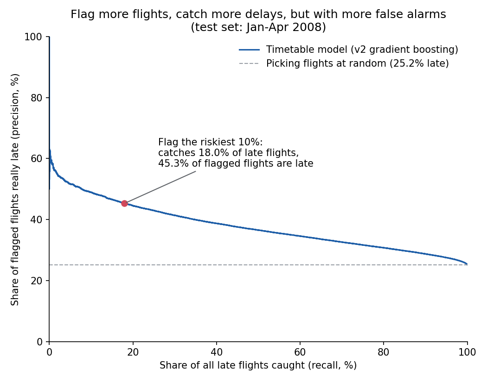

**Can its percentages be trusted?** Same check as Step 6:

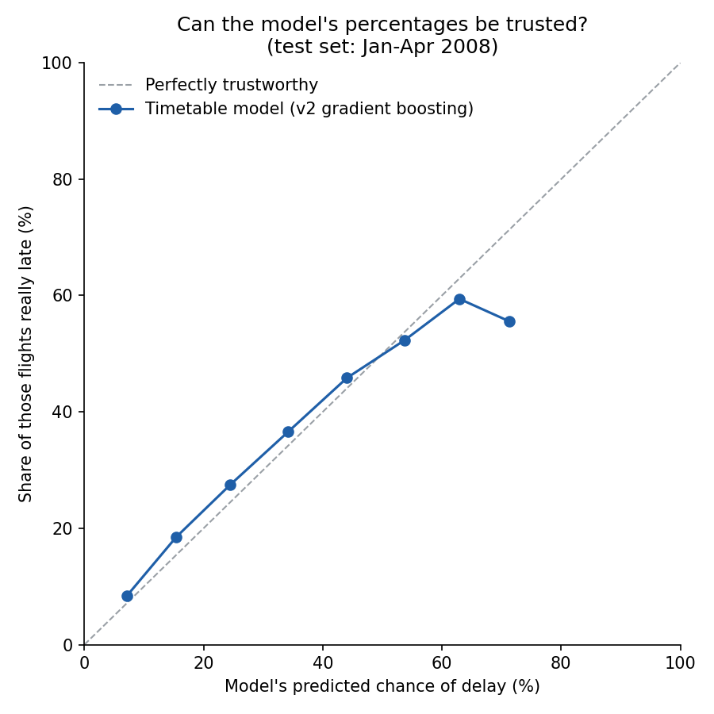

| Predicted chance | Flights | Model's average prediction | Really late |
|---|---|---|---|
| 0–10% | 67,930 | 7.1% | 8.4% |
| 10–20% | 245,336 | 15.4% | 18.5% |
| 20–30% | 231,747 | 24.5% | 27.5% |
| 30–40% | 102,459 | 34.2% | 36.6% |
| 40–50% | 36,640 | 44.1% | 45.9% |
| 50–60% | 9,664 | 53.8% | 52.3% |
| 60–70% | 1,486 | 62.9% | 59.4% |
| 70–80% | 36 | 71.3% | 55.6% |

- **Roughly, but it runs low.** A group's prediction is 2.7 points from reality on average (1.2 for the 2-hour model). It expects 22.6% of 2008 flights to be late; 25.2% were.
- **It is almost never confident.** 98.4% of flights get a chance below 50%, and only 36 get more than 70%, too few to judge (which is why the last dot drops).
- **So what:** it's a *planning* tool. It can point a scheduler at the 10% of slots that need more slack, but that list holds under a fifth of all delays. For on-the-day decisions, use the 2-hour model (Step 5).

## What drives the predictions

`src/what_drives_delays.py` uses **permutation importance** on the timetable model: shuffle one column across the test flights so it no longer matches its flight, and measure how much the AUC drops. Each column is shuffled 5 times and the drops averaged.

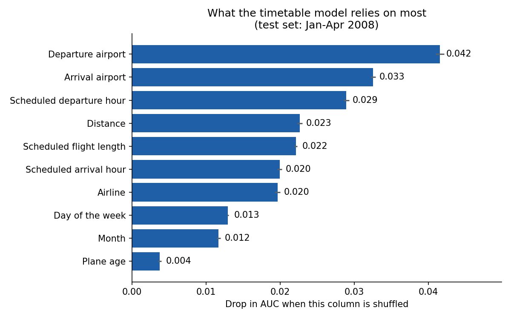

| Column | Drop in AUC when shuffled |
|---|---|
| Departure airport | 0.042 |
| Arrival airport | 0.033 |
| Scheduled departure hour | 0.029 |
| Distance | 0.023 |
| Scheduled flight length | 0.022 |
| Scheduled arrival hour | 0.020 |
| Airline | 0.020 |
| Day of the week | 0.013 |
| Month | 0.012 |
| Plane age | 0.004 |

- **Where a flight goes matters most:** the two airports, then the departure hour.
- **Plane age barely matters (0.004)**, matching the plain comparison above.
- **Pairs share the credit.** Distance and flight length say nearly the same thing, as do departure and arrival hour. Shuffling one leaves the other, so each looks less important than the pair is.
- **This shows what the model uses, not what causes delays.** A busy airport may be late because of congestion, weather or its airlines; the model can't tell those apart.
- **So what:** when planning a timetable, look first at which airports and hours a flight is scheduled into, not at the plane's age.

## Key choices, and why

| Choice | Why |
|---|---|
| A SQLite database, not everything in memory | 31 million rows don't fit comfortably in a laptop's memory. Indexes let each query pull only the rows it needs. |
| Delay rates, not counts | Busy times naturally have more delays, so every comparison uses the *share* of flights that were late. |
| Late = 15+ minutes | The FAA definition. |
| Test on a later year | A random split would let the model learn from days it is later tested on. Train on 2004–2007, test on 2008. |
| Always compare with a benchmark | 0.65 means little on its own. Beating the route's past delay rate (0.589) shows the model learned something history alone doesn't give. |
| Report results in business terms | "The riskiest 10% are late 73% of the time" is something an operations manager can act on. An AUC is not. |
| Repeatable samples | The same setting always picks the same flights, so a rerun gives the same numbers. |
| Airports as categories, not past delay rates | See below. |

**Airports as categories.** scikit-learn's gradient boosting takes at most 255 categories per column, so the 254 busiest airports keep their own label and the other ~60 share one "other" group (0.26% of training flights). I tried the alternative, **target encoding**: replace each airport with the share of its 2004–2007 flights that were late. On the 30% sample it scored slightly *worse*: 0.648 vs 0.654 for the timetable model, 0.761 vs 0.765 for the 2-hour model. On the 1% sample it had scored slightly better, which is why I tested at full size before switching. With enough data, the model learns how each airport behaves at different hours, months and airlines; one average rate throws that away. (`src/airport_encoding.py`, `results/airport_encoding.csv`)

## Limitations

- **The data is old** (2004 to April 2008). Routes and schedules have changed, so the numbers won't carry over without retraining.
- **The test covers only January–April 2008.** Summer thunderstorms are untested.
- **Only flights that arrived are counted.** Cancelled and diverted flights can't be predicted.
- **Weather covers 96 of the 100 busiest airports.** About 9% of test flights have no departure-airport report, about 12% no arrival-airport report.
- **A quarter of flights have no plane age.**
- **Comparisons are not causes.** Other things, like the airline or route, may explain why older planes or evening flights are late more often.
- **The costs in Step 6 are made up** to show the method.
- **The models learn from a 30% sample (8.5 million flights)**, the most my laptop's memory could hold. 10% → 30% added only 0.004, so all the data would probably add very little.

## What I learned

- **Ask when each piece of information becomes known.** A near-perfect score on a messy real-world problem is a warning sign.
- **Build indexes for the queries you will run.** Tracing knock-on delays meant matching 31 million flights by plane and date, so those are the columns I indexed.
- **How you group data can change the answer**, as with actual vs scheduled departure time.
- **Doing the same work in R and Python** showed me how their machine learning tools differ.

## What I'd do next

- Retrain and test on recent data, including summer.
- Predict cancellations too.
- Explain each single prediction, so an operations team can see *why* a flight was flagged.

## Run every script

Every script uses a 1% sample by default (minutes). The numbers here come from `--pct 30` (8.5 million training flights), which takes several hours for the 2-hour scripts and needs about 15 GB of memory. The web page was built with `--pct 30 --show-pct 1`: models trained on 30%, with 1% of test flights listed so the file stays small.

```bash
pip install -r requirements.txt                          # the exact versions used (Python 3.13)
jupyter notebook notebooks/flight_delay_analysis.ipynb   # builds data/Fly.db (set FLY_DATA_DIR to build it elsewhere); about 30 minutes
python src/model_v2.py --db data/Fly.db                  # honest timetable model; same --pct and --seed give the same sample
python src/model_v3.py --db data/Fly.db                  # airport busyness, route history, benchmark, riskiest-10% chart
python src/model_v4.py --db data/Fly.db                  # 2 hours before departure
python src/check_probabilities.py --db data/Fly.db       # can the percentages be trusted? which alert level?
python src/practical_value.py --db data/Fly.db           # timetable model: riskiest 10%, precision-recall, calibration
python src/what_drives_delays.py --db data/Fly.db        # which columns the timetable model relies on most
python src/prediction_time.py --db data/Fly.db           # 4, 2 and 1 hours before departure
python src/download_weather.py --db data/Fly.db          # about 230 MB into data/weather (needs curl)
python src/model_weather.py --db data/Fly.db             # 2-hour model with and without weather
python src/build_web_page.py --db data/Fly.db            # rebuilds docs/flights.json (adds weather if data/weather exists)
python src/airport_encoding.py --db data/Fly.db          # airports as categories vs past delay rates
python src/time_of_day.py --db data/Fly.db               # redraws images/delay_rate_by_time_of_day.png
python src/findings.py --db data/Fly.db                  # day, season and plane-age tables and charts
```

Tools: SQLite (`sqlite3` in Python, `DBI`/`RSQLite` in R), indexed on tail number, date and route. Python: pandas, NumPy, statsmodels, scikit-learn, Matplotlib, seaborn, Plotly. R: dplyr, ggplot2, mlr3, glmnet, ranger, XGBoost.

## Terms used

| Term | Meaning |
|---|---|
| AUC | How well a model ranks late flights above on-time ones. 0.5 is a coin flip, 1.0 is perfect. |
| Target leakage | Giving a model information it would not have when it makes its prediction. |
| Delayed / late | Arriving 15 or more minutes late (FAA definition). |
| Calibration | Whether a model's percentages match reality: if it says 30%, about 30% should be late. |
| Cutoff | The moment the prediction is made. Nothing after it can be used. |
| Time-based split | Train on earlier years, test on a later one, so the model never sees the future. |
| Precision | Of the flights flagged, the share that really are late. |
| Recall | Of all late flights, the share that are flagged. |
| Precision-recall curve | Precision against recall for every length of flagged list. |
| Permutation importance | How much the score drops when one column is shuffled. Bigger drop = the model relies on it more. |
| Benchmark | The simplest sensible way to do the job without a model. Here, ranking flights by their route's past delay rate. |
